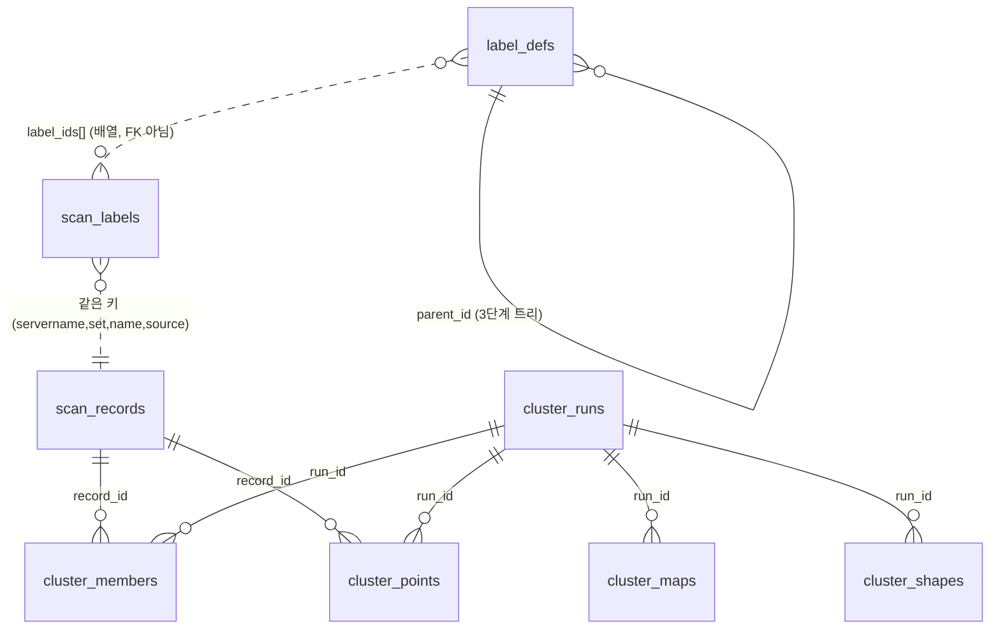

# scanlabel — 데이터베이스 (무엇이 어떻게 저장되나)

> 화면판: 서버의 `GET /guide/db`(「읽는 법」의 세 번째 탭). 이 문서는 컬럼 표 · 조회 SQL 까지 있는 개발자용입니다.

scanlabel 이 PostgreSQL 에 **무엇을, 언제, 어떤 모양으로** 남기는지 설명합니다. 컬럼의 정본은
`scanlabel/data/migrations/*.sql`(번호 붙은 전진 전용 SQL)이고, 이 문서는 그것을 읽는 사람을 위한 지도입니다.
저장 코드는 `scanlabel/data/repository.py`(`Store`, 원시 SQL — ORM 없음), 스키마 이동은 `scanlabel/data/migrate.py` 입니다.
영역별 결정 기록은 `scanlabel/data/__spec__.md`(영문).

- DB 는 scanlabel **전용**입니다(이 PC: `scanlabel`, 포트 5433). fleet(ftpmodule)의 DB 와 섞지 않고, fleet DB 를 읽지도 않습니다.
  fleet 의 값은 HTTP 로 받아 **사본**(`meta`, `features`)으로만 남깁니다.
- 사람이 읽는 시각은 전부 **KST ISO 문자열**(`2026-11-03T06:58:39+09:00`, `text` 컬럼)입니다. `timestamptz` 를 쓰지 않습니다.
- 큰 배열(측정 곡선 · 칸 · 투영식)은 `jsonb` 한 칸에 둡니다. 쿼리로 파헤칠 값이 아니라 통째로 읽고 쓰는 값이기 때문입니다.

## 한눈에 — 세 덩어리



| 덩어리 | 테이블 | 한 줄 |
|---|---|---|
| ① 라벨 | `label_defs` · `scan_labels` | 사람이 정한 것 — 분류 트리와 기록에 붙인 라벨 |
| ② 기록 풀 | `scan_records` · `index_cursors` | scanlabel 이 **본** 기록 전부(라벨 여부 무관)의 모양 스냅샷 |
| ③ 묶음 | `cluster_runs` · `cluster_members` · `cluster_points` · `cluster_maps` · `cluster_shapes` | 프로그램이 계산한 것 — 모양으로 무리 지은 결과 (언제든 다시 계산) |
| 관리 | `schema_migrations` | 적용된 마이그레이션 장부 |

원칙: **① 은 사람의 판단이라 잃으면 안 되고, ③ 은 ② 에서 다시 만들 수 있다.** ② 는 fleet 캐시에서 다시 읽어 복구할 수 있다
(`jobs refeature`).

점선 관계(`label_ids[]`, `scan_labels` ↔ `scan_records`)는 외래키가 **아닙니다**. 둘 다 같은 키로 이어질 뿐입니다 — 아래 「기록의 키」.

## 기록의 키 — 기록 한 건을 부르는 이름

dump 파일 하나에 스캔 기록이 여러 건 들어 있고, 한 건은 이 네 값으로 식별합니다.

| 값 | 뜻 |
|---|---|
| `servername` | 장비 정체성(fleet 의 안정 키). `server_id` 는 fleet 쪽 번호라 **바뀔 수 있어** 키가 아니라 링크용 사본입니다 |
| `set_name` | 파일 묶음 종류, 지금은 `dump` |
| `name` | 파일 이름 |
| `source` | 파일 안의 기록 식별자 `"<tdf>::<dd>"` |

`scan_labels` 와 `scan_records` 는 모두 `UNIQUE (servername, set_name, name, source)` 입니다. 같은 기록은 두 테이블에 같은 키로 한 행씩 있고,
묶음 쪽 테이블은 `scan_records.id` 로 가리킵니다.

## ① 라벨

### `label_defs` — 분류 트리

대분류 › 중분류 › 소분류 **3단계 고정**(`level` 1·2·3). 한 테이블에 `parent_id` 로 자기를 가리키는 트리입니다.

| 컬럼 | 설명 |
|---|---|
| `id` · `parent_id` | 대분류는 `parent_id IS NULL` |
| `level` | 1 · 2 · 3 |
| `name` | 화면에 보이는 이름 |
| `code` · `description` | 선택: 사내 분류 코드 · 한 줄 설명 |
| `case_id` | fleet `acs_case.case_id` 를 가리키는 **soft 참조**(조인하지 않음, SL-CASE-3) |
| `origin` | `seed`(처음 정해 둔 것·마이그레이션 `0003`·`jobs seed-labels`) / `added`(쓰다가 추가) |
| `retired` | 더는 고르지 못하게 — **지우지 않고** 이 플래그만 켭니다 |
| `sort_no` · `author` | 표시 순서 · SSO 자리(지금은 비어 있음) |

제약이 규칙을 SQL 로도 지킵니다(`processing/tree.py` 가 1차, `CHECK` 가 2차).
- `level BETWEEN 1 AND 3`, `(level = 1) = (parent_id IS NULL)` — 대분류만 부모가 없다.
- **같은 부모 아래에서만** 이름이 유일(대소문자 · 앞뒤 공백 무시): 「피크」가 「신호 이상」과 「위치 이상」 아래에 각각 있을 수 있다.
- `code` 는 비어 있지 않으면 전체에서 유일.

실제 분류표 **ID-0603**(`0603.md`)은 마이그레이션 `0003` 이 `migrate up` 때 넣습니다(대 `ID-0603` › 중 category › 소 error, 멱등).

### `scan_labels` — 기록에 붙인 라벨

사람이 라벨을 저장한 기록 한 건 = 한 행.

| 컬럼 | 설명 |
|---|---|
| `servername` · `server_id` · `set_name` · `name` · `source` | 기록의 키(위) |
| `label_ids bigint[]` | `label_defs.id` 목록 — 하나 이상, **어느 단계든**(대분류만 붙여도 됨). GIN 인덱스. 배열이라 FK 가 아니며, 존재 · 은퇴 검사는 저장 전에 `check_selection` 이 합니다 |
| `sig` | 라벨한 시점의 파일 세대(정보용, 키 아님) |
| `scan_enum` | 스캔 종류 — 비교는 같은 종류끼리 |
| `meta jsonb` | 표시용 메타 사본(척 · 센서 · 시각 …) |
| `features jsonb` · `feature_version` | 모양 스냅샷과 그 판 (아래 「모양 스냅샷」) |
| `author` · `created_at` · `updated_at` | SSO 자리 · KST ISO |

- `CHECK (cardinality(label_ids) > 0)` — 라벨이 비면 행을 **지웁니다**(`PUT /labels` 에 빈 `label_ids` = 삭제).
- 스냅샷을 라벨 행에 **복사해 둡니다**: 원본 파일이 fleet 캐시에서 사라져도 닮은 기록 찾기(`eval` · `similar`)가 이 행만으로 됩니다.
- 라벨 저장은 항상 fleet 에서 **새로** 읽어(`fresh`) 그 시점의 세대와 모양을 남기고, 같은 스냅샷을 `scan_records` 에도 넣습니다(SL-POOL-1).

## ② 기록 풀

### `scan_records` — 본 기록 전부

라벨이 없는 기록까지 모양을 한 벌씩 둡니다. 묶음은 이 테이블만 읽습니다.

| 컬럼 | 설명 |
|---|---|
| 키 4값 · `server_id` · `sig` | 위와 같음. `sig` = **마지막으로 본** 세대 |
| `scan_enum` · `chuck_id` · `sensor_id` | **묶음 범위**를 정하는 세 열(없으면 `''`). `meta` 에서 꺼내 둔 것이라 인덱스를 탈 수 있다(`0005` · `0006`) |
| `meta` · `features` · `feature_version` | 메타 사본 · 모양 스냅샷 · 그 판 |
| `seen_at` | 처음 본 때 |
| `updated_at` | 마지막으로 **특징을 쓴** 때 |
| `seq` | 풀이 바뀐 순서 번호 — 시퀀스 `scan_records_seq` |

**`seq` 가 하는 일.** 같은 파일을 다시 열어도 `sig`(세대) · `feature_version` · `scan_enum` · `chuck_id` · `sensor_id` 가 그대로면 **행을 쓰지 않습니다**
(`upsert_records` 의 `ON CONFLICT … DO UPDATE … WHERE … IS DISTINCT FROM`). 바뀔 때만 새 `seq` 를 받습니다.
그래서 `cluster_runs.pool_seq` 보다 큰 `seq` 가 풀에 있으면 「묶음이 낡았다」(`stale`)고 판단할 수 있습니다 — 열기만 해서는 낡아지지 않습니다.

풀에 들어오는 길은 셋입니다: ① 화면에서 파일을 열 때(`POST /labels/similar`) ② 라벨 저장 ③ `jobs index`(fleet `/generations` 를 따라가며, 캐시만 읽음).

### `index_cursors` — 색인 위치

`jobs index` 가 fleet `/generations` 를 어디까지 읽었나. `set_name` 마다 한 행(`after_id` = fleet 세대 id, 도착 순서 커서).
파일을 처리하는 대로 풀에 넣고, 도중에 실패해도 처리한 데까지의 커서는 저장하므로 다음에 이어서 읽습니다.

### 모양 스냅샷 `features` (jsonb)

`scan_labels.features` 와 `scan_records.features` 는 **같은 모양**입니다(`processing/shape/features.py::record_features`).
정규화 **전** 값만 남기고, 비교용 정규화는 읽을 때 합니다 — 그래서 비교 방식을 바꿔도 원본 없이 스냅샷만으로 다시 계산됩니다.

```jsonc
{
  "version": 1,                         // FEATURE_VERSION — 스냅샷 모양이 바뀌면 올린다
  "channels": {
    "tr": {                             // 채널 이름은 dump 의 value 키 그대로
      "path":  [ /* 128개 */ ],         // 측정 순서 곡선을 PATH_N 점으로 줄인 것
      "grid":  [ /* 16×16 = 256개, 빈 칸은 null */ ],   // (x,z) 평면 칸 평균. 선 스캔이면 null
      "stats": { "n": 0, "min": 0, "max": 0, "mean": 0, "std": 0 }
    }
    // "txh", "tyh" … 채널마다
  }
}
```

`feature_version` 이 코드의 `FEATURE_VERSION` 과 다르면 낡은 스냅샷입니다. 배포 후 `jobs refeature` 가 라벨된 기록과 풀을 새 판으로 바꾸고
(fleet 캐시에서 다시 읽음), 그 다음 `jobs cluster` 를 돌립니다.

## ③ 묶음 (클러스터)

묶기는 **(스캔 종류, 척, 센서)마다 따로** 합니다(`group_key` = `"종류|척|센서"`). 한 범위 안에서 라벨된 기록 전부 + 라벨 없는 최근 `CLUSTER_MAX_N`(800)건을 묶습니다.
잣대(`method`)는 둘 — `skew`(채널 간 편차) · `pca`(주성분) — 이고, **같은 풀을 두 잣대로 따로 묶어** 각각 저장합니다. 화면이 골라 봅니다.

### `cluster_runs` — 묶음 계산 한 번

| 컬럼 | 설명 |
|---|---|
| `set_name` · `method` | 이 두 값마다 **최신 한 판만** 남는다 |
| `n_records` · `n_clusters` · `n_unclustered` · `truncated` | 묶어 본 수 · 묶음 수 · 묶이지 않은 수 · 상한에 걸려 빠진 수 |
| `min_size` · `feature_version` | 그때의 `CLUSTER_MIN_SIZE` · 스냅샷 판 |
| `threshold` | 문턱 없는 묶기(`0009`)부터 `NULL` — 그 전 판에만 값이 있다 |
| `pool_seq` | 묶을 때 풀의 최대 `seq` (낡음 판단 기준) |
| `next_no` | 다음에 새 묶음에 줄 번호 — 번호를 이어받기 위해(SL-CLU-13) |
| `changes jsonb` | 지난 판과 견준 변화 `{kept, moved, joined, released, out, new_clusters, closed_clusters}`. 지난 판이 없으면 `NULL` |
| `created_at` | KST ISO |

### 자식 테이블 — 모두 `run_id → cluster_runs ON DELETE CASCADE`

| 테이블 | 키 | 담는 것 |
|---|---|---|
| `cluster_members` | `(run_id, record_id)` | 묶음에 든 기록. `cluster_no`(1부터) · `score`(대표와의 유사도, 대표 자신은 1) · `representative` · `scan_enum`/`chuck_id`/`sensor_id`. **묶이지 않은 기록은 행이 없다** |
| `cluster_points` | `(run_id, record_id)` | 묶어 본 기록 **전부**(묶이지 않은 것 포함)의 지도 2D 자리 `x` `y` + 범위 3열 |
| `cluster_maps` | `(run_id, group_key)` | 범위 하나의 **투영식**(jsonb). 이것이 있어야 그 판에 없던 새 기록도 같은 지도에 놓을 수 있다 |
| `cluster_shapes` | `(run_id, cluster_no)` | 묶음의 **평균 그림**(jsonb) — 목록 · 지도가 구성원 수백 건을 매번 읽지 않게 |

- `cluster_maps.proj`: `skew` 는 `{landmarks:[record_id…], pinv, mean, baseline}`(기준점 24개로 2D 자리를 정하는 식), `pca` 는 주성분 모델
  `{method:"pca", kind, keys, layout, median, factor, … , baseline}`. 범위마다 수천 개의 수가 되므로 `cluster_runs` 의 한 칸이 아니라
  **범위마다 한 행**으로 두어 한 범위만 읽습니다(`0007`).
- `cluster_shapes.shape`: 채널마다 `path`(평균 곡선) · `lo`/`hi`(25·75 백분위 띠) · `grid`(칸 평균) 와 `n`. `0009` 이전 판은 **처음 읽을 때 한 번** 구성원에서 만들어 채웁니다.
- 「라벨됐나」는 컬럼이 아니라 `scan_labels` 와의 `EXISTS` 로 그때그때 계산합니다(라벨이 바뀌어도 묶음을 다시 쓰지 않는다).
- `cluster_members` / `cluster_points` 는 `scan_records` 도 `ON DELETE CASCADE` 로 가리키지만 풀의 행은 지우지 않습니다.

### 묶음 번호가 이어지는 방법

`save_cluster_run` 은 한 트랜잭션에서 **같은 `(set_name, method)` 의 옛 판을 지우고 새 판을 넣습니다**(자식은 CASCADE).
지우기 전에 `carry_of` 가 옛 판의 `(cluster_no, 구성원, 대표)` 를 읽어 `shape.cluster(previous=…)` 에 넘기고, 닮음이 그대로인 묶음은 지난 번호를 이어받습니다.
번호는 한 번 쓰면 재사용하지 않으므로 `next_no` 를 판마다 남깁니다. 지난 판과의 차이는 `changes` 에 남습니다.

## 값이 흐르는 길

```
fleet (HTTP, 캐시만)                 scanlabel DB
────────────────────                 ───────────────────────────────────────────────
dump 파일의 기록 ──record_features──▶ scan_records  (파일 열기 · jobs index · 라벨 저장)
                                         │  features(정규화 전 스냅샷)
사람이 라벨 저장 ───────────────────▶ scan_labels   (같은 스냅샷 복사 + label_ids[])
                                         │
jobs cluster / 「다시 묶기」 ◀───────────┘ scan_records 를 읽어 범위마다 묶음
        └▶ cluster_runs ▶ cluster_members · cluster_points · cluster_maps · cluster_shapes
```

## 지워지는 것 · 안 지워지는 것

| 대상 | 규칙 |
|---|---|
| `label_defs` | 지우지 않는다 — `retired` 로 은퇴 |
| `scan_labels` | 라벨을 비우면(`label_ids` 빈 배열 / `DELETE /labels`) 그 행을 삭제 |
| `scan_records` | 지우지 않는다. 같은 키는 갱신(변할 때만) |
| `cluster_*` | 같은 `(set_name, method)` 의 다음 판이 저장될 때 옛 판이 통째로 삭제(CASCADE) |
| `schema_migrations` | 영구 |

## 스키마 바꾸는 법

- **새 파일 `data/migrations/NNNN_*.sql`**. 적용된 파일은 **절대 고치지 않습니다** — 파일 바이트의 체크섬이 `schema_migrations.checksum` 과 다르면 하드 에러입니다.
  (`.gitattributes` 가 `.sql` 의 줄바꿈 변환을 막는 것도 같은 이유.)
- 파일 하나 = 트랜잭션 하나. 실행기는 어드바이저리 락(`0x7363_616E_6C01`)을 잡아 동시 실행을 막습니다. fleet 의 락 키와 달라서 한 PostgreSQL 인스턴스에 두 DB 가 같이 있어도 됩니다.
- `Store` 는 시작할 때 스키마 버전을 확인하고 **다르면 시작을 거부**합니다(`SchemaError`). 적용은 하지 않습니다 — 먼저 `python -m scanlabel.data.migrate up`.
- `python -m scanlabel.data.migrate status` — 미적용이 있으면 종료 코드 1.

| 번호 | 내용 |
|---|---|
| 0001 | `label_defs` · `scan_labels` |
| 0002 | `scan_records`(+`seq`) · `index_cursors` · `cluster_runs` · `cluster_members` |
| 0003 | 분류표 ID-0603 을 트리로 입력(데이터 마이그레이션, 멱등) |
| 0004 | `cluster_points` · 투영식(`maps`) — 묶음 지도 |
| 0005 | 묶는 범위에 **센서** 추가(`sensor_id`) |
| 0006 | 묶는 범위에 **척** 추가(`chuck_id`) |
| 0007 | 잣대 둘(`method`) · `maps` → `cluster_maps` 로 분리 |
| 0008 | 이어서 묶기(`next_no` · `changes`) |
| 0009 | `cluster_shapes`(평균 그림) · `threshold` NULL 허용(문턱 없는 묶기) |

## 직접 들여다보기 (읽기 전용 예시)

```sql
-- 이 PC: psql -h 127.0.0.1 -p 5433 -U postgres -d scanlabel

-- 라벨 트리를 경로로
SELECT c.id, g.name || ' › ' || m.name || ' › ' || c.name AS path
FROM label_defs c JOIN label_defs m ON m.id = c.parent_id JOIN label_defs g ON g.id = m.parent_id
WHERE c.level = 3 AND NOT c.retired ORDER BY g.sort_no, m.sort_no, c.sort_no;

-- 라벨된 기록 수 / 풀 전체 수
SELECT (SELECT count(*) FROM scan_labels) AS labelled, (SELECT count(*) FROM scan_records) AS pool;

-- 묶음 범위별 풀 크기
SELECT scan_enum, chuck_id, sensor_id, count(*) FROM scan_records GROUP BY 1,2,3 ORDER BY 4 DESC;

-- 잣대별 최신 판과 낡았는지
SELECT r.id, r.method, r.n_clusters, r.n_unclustered, r.created_at,
       EXISTS (SELECT 1 FROM scan_records s WHERE s.set_name = r.set_name AND s.seq > r.pool_seq) AS stale
FROM cluster_runs r ORDER BY r.set_name, r.method;

-- 최신 skew 판의 묶음 크기
SELECT cluster_no, count(*) FROM cluster_members
WHERE run_id = (SELECT id FROM cluster_runs WHERE set_name = 'dump' AND method = 'skew')
GROUP BY 1 ORDER BY 2 DESC;

-- 낡은 스냅샷(refeature 대상) — FEATURE_VERSION 은 코드의 값으로
SELECT count(*) FROM scan_records WHERE feature_version <> 1;
```

데이터를 직접 고치지 마세요. 라벨은 API/화면으로, 풀과 묶음은 `jobs` 로 만들고, 스키마는 마이그레이션으로만 바꿉니다.
